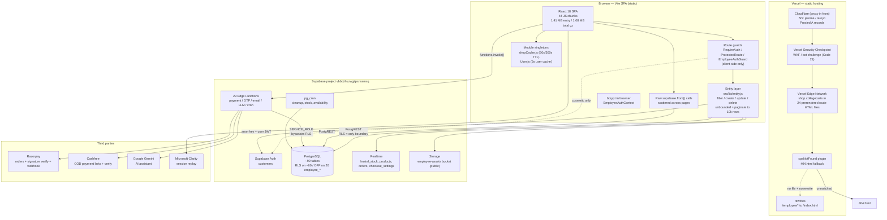
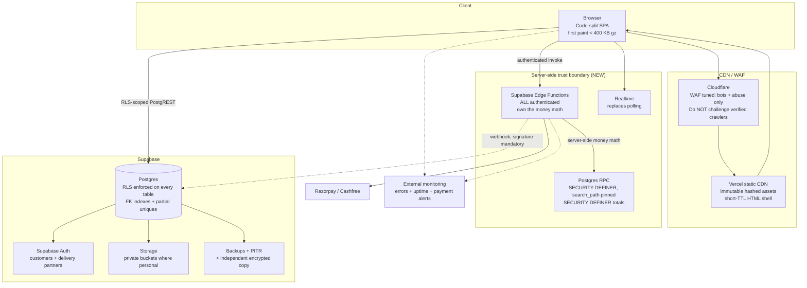

# CollegeCart — Production Readiness Audit & Scalability Plan

**Audit type:** Read-only. No application code, schema, data, configuration, DNS, or infrastructure was modified.
**Date:** 2026-10-09
**Scope:** Repository at `/Users/alok/Downloads/Collegecart web/collegecart-final`, Vercel project `collegecart-final` (read-only API), and the live Supabase project (read-only PostgREST probes using the **public anon key only**).
**Standard applied:** Every finding is labelled **[VERIFIED]** (directly observed in code, config, or a live read-only probe), **[LIKELY]** (strong evidence, one unconfirmed link), or **[UNKNOWN]** (requires dashboard access or explicit approval).

> **Handling note:** This report contains no secret values. Where a secret class is referenced, only the *name* and *location* are given. All credential rotation work is listed in §12 (Never Automate).

---

## 0. Executive Summary

CollegeCart is a **Vite + React single-page application** (not Next.js) with a **Supabase backend** (PostgreSQL + RLS + Auth + Storage + Realtime + 29 Edge Functions). All database access is **direct from the browser** via `supabase-js`; there is no BFF or API layer.

The platform functions and the business logic is sound in intent, but it is **not production-hardened**. Three classes of problem dominate:

1. **Critical authorization failure.** A read-only probe against live production, using only the public anon key that ships inside the browser bundle, successfully returned **942 customer records (email, phone, full name), 20 delivery-partner rows including plaintext `password` and `wallet_balance`, employee `password_hash` and live `session_token` values, 2,180 wallet ledger rows, 508 cart rows and 64 live OTP records.** This is not a theoretical finding — it was reproduced against production.
2. **Money is computed and trusted on the client.** Order totals, delivery charges, loyalty and commission are all derived in the browser, and `orders.total_amount` plus `is_paid` are written from the client. No server-side recomputation or amount comparison exists anywhere in the payment path.
3. **Correctness debt from rapid iteration.** 35 migrations with three mutually conflicting schema definitions, 20 employee tables with RLS explicitly disabled, a 10% commission duplicated across 5 files with two different roundings, and a documented ₹2,760 historical over-credit.

**The single most valuable action** is to fix the RLS posture immediately. It is a small, well-understood change with an outsized effect, and it is currently an active data breach.

---

## 1. Current Architecture



**Critical path note:** There is **no server-side trust boundary**. Route guards are cosmetic; the Supabase anon key is public by design; therefore **Postgres RLS is the sole authorization boundary** — and on several tables it is currently not enforced.

---

## 2. Verified Current-State Inventory

### 2.1 Application **[VERIFIED]**

| Item | Finding | Evidence |
|---|---|---|
| Framework | **Vite 6.4.3 + React 18 SPA**, `react-router-dom` v6. **Not Next.js.** | `package.json`, `vite.config.js` |
| Routes | 40 declared entries (26 top-level + 18 nested employee) | `src/App.jsx:195-348` |
| Public routes | 11, incl. `/`, `/Shop`, `/Categories`, `/CategoryProducts`, `/ProductDetails` | `src/App.jsx:80-85,138-162` |
| Admin routes | 2, guarded by `user.role === 'admin'` | `src/App.jsx:270-291` |
| Employee routes | 18 under `/employee/:employeeSlug`, guard checks **slug only, no per-route permission check** | `src/App.jsx:315-345`, `EmployeeAuthGuard.jsx:27-30` |
| Backend access | Direct `supabase-js` from browser; `@base44/sdk` declared but **never imported** | `src/api/base44Client.js`, `src/lib/entity.js` |
| Entity reads | 209 call sites; **178 pass no limit**; `Entity.filter` paginates to **10,000 rows** in 1000-row pages | `src/lib/entity.js:74-99` |
| Polling loops | 20 `setInterval` loops; **1 s** cart-count poll, **3 s** ×2, **5 s** full order-table pull | see §5.5 |
| Realtime | 9 channels, **all correctly unsubscribed** — no leak found | `Shop.jsx:249`, `useRealtimeStock.js:92,163,226` |
| JS payload | **1.08 MB gzipped total**; entry 347 KB gz; **938 KB gz on first paint** | `dist/`, `dist/index.html` |
| Preloaded on every page | `xlsx` 136 KB gz + `jspdf/html2canvas` 170 KB gz + `recharts` 106 KB gz = **412 KB gz** of admin/export-only code | `dist/index.html` modulepreload |
| Per-route splitting | **Absent for all customer routes** — `Shop`, `Cart`, `Orders`, `Profile`, `ProductDetails` are all inside the entry chunk | verified by string presence in `index-*.js` |
| Largest asset | `bot-icon.png` **1.57 MB**, `splash-delivery.gif` 535 KB | `dist/` |
| Dead deps | `three` (525 KB), `react-quill` declared, never imported | `package.json:79,86` |
| Env hygiene | `.env` was **committed in history** (`77dfe89`), removed in `e6116e2`. Currently only `.env.example` tracked. | `git log`, `git ls-files` |

### 2.2 Vercel **[VERIFIED via read-only API]**

| Item | Finding |
|---|---|
| Project / plan | `collegecart-final`, project `prj_b2lPZJBrDfBu7p5UG64dCFKFHMFE`, team `global-servicexs-projects` |
| Framework | `vite`, `outputDirectory: dist`, `buildCommand: npm run build` |
| Node | **Project dashboard says `24.x`; `package.json` pins `22.x`** — mismatch |
| Regions | **Not configured** |
| Functions | **None** — pure static hosting; therefore no function-duration or serverless-connection risk |
| SSO / Deployment Protection | `all_except_custom_domains` — production custom domain is public, preview deployments require login |
| Firewall | **None configured** (the challenge seen is the built-in Security Checkpoint, not a configured rule set) |
| Speed Insights / Web Analytics | **Both enabled** |
| Cron | Enabled, **`definitions: []`** — no Vercel cron jobs defined |
| Deployment retention | 30 days, 10 kept |
| Env separation | Production-only: `VITE_SUPABASE_URL`, `VITE_SUPABASE_ANON_KEY`, `VITE_RAZORPAY_KEY_ID`, `VITE_APP_URL`, `KERNEL_API_KEY`, `FLAGS_SECRET`. **Preview lacks all four `VITE_*`** → preview builds should fail `gen-sitemap`, confirming the guard works |
| Aliases | `shop.collegecarts.in`, `collegecart-final-six.vercel.app` + 2 others |

### 2.3 Cloudflare / CDN **[VERIFIED]**

| Item | Finding |
|---|---|
| In use | **Yes.** NS `jerome.ns.cloudflare.com`, `lauryn.ns.cloudflare.com`; `shop.collegecarts.in` → `104.21.16.126`, `172.67.212.126` (Cloudflare proxy range) |
| Layer order | Cloudflare proxy → Vercel Security Checkpoint → Vercel static CDN |
| Observed behaviour | Unauthenticated non-browser requests receive **HTTP 429 + "Vercel Security Checkpoint / Code 21"** on **every path**, including `/robots.txt`, `/Shop` and 404 paths |

**This matters for the audit:** the WAF blocks crawlers and automated monitoring on every route, not just abusive ones. It is a measurable SEO and uptime-monitoring problem in its own right (§5.7).

### 2.4 Database **[VERIFIED]**

~90 tables. 35 migrations + 6 loose SQL files. 117 `CREATE INDEX` statements.

**Verified live authorization posture** — read-only probes with the public anon key, **no authentication, no service role, no writes**:

| Table | HTTP | Rows visible | Contains |
|---|---|---|---|
| `users` | 206 | **942** | `email`, `phone_number`, `full_name` — **customer PII** |
| `delivery_persons` | 206 | **20** | **`password` (plaintext)**, `email`, `phone_number`, `wallet_balance` |
| `employee_accounts` | 206 | **3** | **`password_hash`** |
| `employee_sessions` | 206 | **13** | **`session_token`** |
| `wallet_transactions` | 206 | **2,180** | full delivery-partner earnings ledger |
| `cart_items` | 206 | **508** | live customer carts |
| `loyalty_transactions` | 206 | **2,258** | balances |
| `otp_codes` | 206 | **64** | live OTP codes |
| `orders` | 200 | 0 | table currently empty; policy not confirmed as restrictive |
| `cod_submissions`, `support_tickets`, `referrals` | 200 | 0 | empty |

**Financial data model:**
- Money is `NUMERIC` (correct — no floats in schema), but **scale is unconstrained** on the core columns (`products.price NUMERIC`, `delivery_persons.wallet_balance NUMERIC` with `DEFAULT 0` but nullable).
- **No `payments` table exists.** Payment state lives in loose text columns `orders.payment_id`, `cod_payment_id`, `cod_payment_status` with **no unique constraint**.
- Denormalised counters (`total_earnings`, `lifetime_earnings`, `wallet_balance`, `cod_held`, `cod_balance`) sit beside the ledger with **no reconciliation trigger**.
- `20260513000004` disables RLS on **20** employee tables and issues `GRANT ALL ... TO anon, authenticated` (lines 9–28, 42–43). This is confirmed live by the probes above.

**Stock concurrency:** `reserve_stock` / `deliver_stock` / `release_stock` use `SELECT ... FOR UPDATE` — correct pessimistic locking (`20260506000007_stock_no_dollar_quotes.sql:22-49`). **However** `products.id` was retyped to `text` in `20260429070000` while the stock functions (dated later, `20260506…`) declare `p_product_id UUID`, producing a `text = uuid` type mismatch. **Whether stock RPCs currently work is [UNKNOWN]** and needs a staging test.

### 2.5 Edge Functions **[VERIFIED]**

29 deployed functions. **18 use `SUPABASE_SERVICE_ROLE_KEY` (bypasses RLS) with zero authorization checks in the function body.** All CORS headers are `Access-Control-Allow-Origin: *`.

Highest-risk functions:
- **`verify-cod-payment`** — no auth check, service-role client, **trusts a caller-supplied `orderId`** and reports payment status. Any caller can query any order's COD payment state.
- **`create-razorpay-cod-order`**, **`verify-razorpay-cod-payment`**, **`create-wallet-topup-payment`** — no auth check; `amount` taken from the request body with only `amount <= 0` validation.
- **`razorpay-webhook`** — signature verification is **conditional**: `if (RAZORPAY_WEBHOOK_SECRET && signature)`. **If the secret is unset, the webhook is accepted unverified.** Whether it is set in production is **[UNKNOWN]**.
- **`reload-schema`**, **`create-stock-functions`**, **`setup-stock-functions`** — schema/DDL helpers reachable as HTTP endpoints. `exec_sql` is **not** defined in any migration; if it exists in the live database, these are unauthenticated DDL endpoints.
- **Duplicate/dead functions:** `createCashfreeOrder` vs `create-cashfree-order`, `verifyCashfreePayment` vs `verify-cashfree-payment`; `CashfreePayment.jsx` component is imported by nothing yet carries a 5-minute polling loop.

### 2.6 Background jobs **[VERIFIED]**

- **`pg_cron`** schedules exist in SQL: `cleanup_old_logs`, db cleanup, stock, product-availability. Actual live schedule state is **[UNKNOWN]** (dashboard access required).
- **No Vercel cron jobs** (`definitions: []`).
- **`20260516000001_db_size_optimization.sql` performs destructive retention DELETEs on every run** if scheduled: `error_logs` >14 d, `admin_alerts`, `notifications` >30 d, `chat_messages` >30 d. It also **mass-nulls user content**: `users.profile_photo`, `users.avatar_url`, `categories.image_url` set to NULL.
- `logErrorToDB` is the app's only error sink — writes to the `error_logs` table which the same cron prunes after 14 days.

---

## 3. Top Risks, Ranked

Severity × Likelihood × Business impact. **Rank 1 is an active breach.**

| # | Risk | Severity | Likelihood | Business impact | Status |
|---|---|---|---|---|---|
| **1** | **Anon key reads 942 customer PII rows, 20 plaintext delivery-partner passwords + wallet balances, employee password hashes and live session tokens** | **Critical** | **Confirmed live** | DPDP/GDPR-class breach exposure, partner impersonation, employee account takeover, direct financial theft path | **[VERIFIED] — happening now** |
| 2 | `orders.total_amount` and `is_paid` are client-supplied; `verify-razorpay-payment` checks only the HMAC signature, never compares amounts | Critical | High | Free orders at scale; revenue loss; no payment proof stored | **[VERIFIED]** |
| 3 | `verify-cod-payment` unauthenticated + service-role + caller-supplied `orderId` | Critical | High | Order/payment-state enumeration by anyone with the anon key | **[VERIFIED]** |
| 4 | Payment success shown before entitlement write; `Subscription.jsx:205-233` swallows the failure | Critical | Medium | **Customer pays, loses money, no Premium** — no refund path | **[VERIFIED]** |
| 5 | Commission credited twice (256 duplicate rows, ₹2,760 over-credit) — DB-level uniqueness index is **commented out** | High | High | Partner trust, payout disputes, unrecoverable ledger ambiguity | **[VERIFIED]** |
| 6 | `collect_cod_cash` not idempotent — no "already collected" guard | High | Medium | Wallet double-deduction | **[VERIFIED]** |
| 7 | No independent backup; DB and Storage have separate (Storage: unverified) coverage; no restore drill | High | Medium | **Unbounded data loss on any DB incident** | **[UNKNOWN]** — must verify in dashboard |
| 8 | 1.08 MB gz JS, 938 KB on first paint; 412 KB of it admin-only | High | High | Mobile conversion loss on a campus audience with metered data | **[VERIFIED]** |
| 9 | `FloatingCartButton` polls every **1 s** forever, ungated by tab visibility | High | High | Sustained DB load from idle tabs; scales linearly with idle sessions | **[VERIFIED]** |
| 10 | `Order.list()` every 5 s and full `orders` scan every 60 s from admin dashboards | High | Medium | Admin page load will degrade non-linearly as orders grow | **[VERIFIED]** |
| 11 | `wallet_transactions.delivery_person_id` and `.order_id` have **no index** — every earnings query seq-scans 2,180+ rows | Medium | High | Slow payouts as the ledger grows | **[VERIFIED]** |
| 12 | WAF 429s legitimate crawlers and all automated monitoring | Medium | High | SEO crawl budget loss; **no external uptime monitoring is possible** | **[VERIFIED]** |
| 13 | Three conflicting schema definitions; `products.category_id` FK was dropped and never restored | Medium | Medium | Orphaned categories; unpredictable behaviour across environments | **[VERIFIED]** |
| 14 | `.env` with 5 real key names committed in history `77dfe89` | Medium | Medium | Credential exposure window; rotation still outstanding | **[VERIFIED]** |
| 15 | `otp_codes` readable by anon; `verify_otp` has no attempt limit | Medium | Medium | Account takeover via OTP brute-force/read | **[VERIFIED]** |
| 16 | Delivery OTP generated with `Math.random()` (`Cart.jsx:1208`), not a CSPRNG | Medium | Medium | Weakened delivery-verification control | **[VERIFIED]** |
| 17 | 3 independent cart-write implementations (Shop / Cart / CategoryProducts) with different semantics | Medium | Medium | Cart drift, lost writes, double rows | **[VERIFIED]** |
| 18 | `idempotencyKeyRef` is dead code; `withRetry` can create duplicate orders | Medium | Medium | Duplicate orders on network timeout | **[VERIFIED]** |

---

## 4. Findings by Area

### 4.1 Vercel
1. **[VERIFIED]** Static hosting only — no function duration, concurrency or connection-pooling risk. This is a genuine strength; **do not add serverless functions without measured need.**
2. **[VERIFIED]** No region configured. Irrelevant for static delivery, but **matters if Edge Functions or a BFF are introduced** — Supabase region must then be matched (see §10).
3. **[VERIFIED]** Node version mismatch: dashboard `24.x` vs `package.json` `22.x`. Pin one.
4. **[VERIFIED]** No `Cache-Control` on JS/CSS. Vercel applies `immutable` to hashed assets automatically, but `index.html` and the 24 prerendered HTML files need an explicit short TTL to avoid serving a stale shell after deploy.
5. **[VERIFIED]** `vercel.json` has no `crons`; all scheduling is `pg_cron`. Acceptable, but means **no scheduled job runs if the DB is unreachable**, and there is no queue.
6. **[VERIFIED]** `chunkSizeWarningLimit: 1000` masks the 1.41 MB entry warning. Remove once splitting is fixed.
7. **[LIKELY]** `ssoProtection: all_except_custom_domains` is correct and should be retained.

### 4.2 Supabase & connection management
1. **[VERIFIED]** All traffic is PostgREST (HTTP), which uses **Supavisor's transaction mode** — appropriate for a serverless/SPA workload. **No action needed.** This is the correct current design.
2. **[VERIFIED]** If Edge Functions begin doing sustained multi-statement work, they currently create a **new `createClient` per invocation** with no pooling. Acceptable at current volume; revisit above ~10 rps sustained.
3. **[UNKNOWN]** Supabase plan tier, connection limits, and current DB size — dashboard access required. This determines whether PITR is available (see §4.6).

### 4.3 Database
1. **[VERIFIED] RLS is the failure point, not connection management.** See §2.4 live table and §5.1.
2. **[VERIFIED]** `wallet_transactions` missing indexes on `delivery_person_id` and `order_id`. Target: the partner earnings rollup and the reconcile `PARTITION BY delivery_person_id`. Trade-off: two extra indexes on a 2,180-row table — negligible write cost, large read win. **Note `wallet_transactions` will grow without bound** (financial ledger), so this index is a prerequisite, not an optimisation.
3. **[VERIFIED]** Missing FK indexes across ~30 tables (§ full list in schema audit). Prioritise only those on hot paths: `refunds.order_id`, `campaign_usage.campaign_id`, `loyalty_transactions.order_id`, `support_tickets.order_id`.
4. **[VERIFIED]** `20260513000001_performance_indexes.sql` **cannot execute** — references `created_date` on tables that only have `created_at`, a `wishlist`/`wishlists` typo, and `pg_trgm` which no migration installs. **Verify whether it partially applied in production.**
5. **[VERIFIED]** `products.category_id` FK was dropped (`20260429080000`) and never restored — categories are not referentially enforced.
6. **[VERIFIED]** `link_user_by_email` performs `UPDATE users SET id = ...` on a primary key that ~20 FKs reference, with **no `ON UPDATE CASCADE` anywhere** — will abort if any child row exists.
7. **[VERIFIED]** `calculate_stock_order_totals` trigger recomputes `COUNT/SUM` over the whole item set on **every** INSERT/UPDATE/**DELETE** → O(n²) on bulk imports.
8. **[VERIFIED]** Money scale unconstrained on core columns; `DEFAULT 0` without `NOT NULL` means a NULL write silently zeroes `balance + x`.
9. **[VERIFIED]** `orders.items` JSONB is the line-item price authority with no reconciliation to `products.price`.
10. **[VERIFIED]** `pg_trgm` missing → **no trigram indexes**, so product/category search is sequential. Relevant to search performance.

### 4.4 Backups & disaster recovery — **all [UNKNOWN], requires dashboard**
1. **[UNKNOWN]** Whether Supabase automated backups are enabled, their retention, and **whether PITR is available** (plan-dependent).
2. **[UNKNOWN]** Whether Storage objects (`employee-assets`, product images, profile photos) have any independent recovery coverage. **Database backup alone would not restore user-uploaded files.**
3. **[UNKNOWN]** Whether any off-platform backup exists. **No backup tooling exists in the repository** — only ad-hoc local JSON exports in `supabase/backups/` (gitignored), which contain real partner names and earnings and are **not** a disaster-recovery capability.
4. **[VERIFIED]** Schema is only reproducible by replaying 35 migrations with three conflicting definitions and several non-idempotent files — **a fresh-database restore from migrations is not currently reliable.** A dump-based restore is the only trustworthy path today.

### 4.5 CDN & caching
1. **[VERIFIED]** Cloudflare sits in front of Vercel's CDN, which **already** provides global CDN, HTTP/2–3, and automatic immutable caching for hashed assets. Cloudflare's marginal value here is **WAF/bot management and origin shielding** — and it is actively **hurting** (§4.6).
2. **[VERIFIED]** Current behaviour: the WAF 429s all non-browser clients on every path.
3. **[VERIFIED]** No `Cache-Control` for the HTML shell; `vercel.json` sets a 1-day CDN TTL only for `llms.txt`, `ai-catalog.json`, sitemaps, `robots.txt`, manifests.
4. **Explicitly must never be cached** (per requirement): authenticated responses, `cart_items`, `wallet_transactions`, `withdrawal_requests`, `orders`, `users`, `otp_codes`, `employee_*`, `delivery_persons`, payment/webhook responses, admin data. **Today none of these are cached by any CDN layer** — verified — but this must remain an explicit constraint, because the app's browser-side `shopCache` and React-Query are separate concerns.

### 4.6 Reliability, observability & security
1. **[VERIFIED]** Error monitoring is a **self-hosted table** (`error_logs`), pruned after 14 days, with **no external alerting**. A silent failure is indistinguishable from no traffic. `main.jsx:60-69` additionally **suppresses** `AbortError` and network-error classes in production console capture — precisely the signals needed for diagnosis.
2. **[VERIFIED]** No request correlation IDs anywhere. No structured logging. No uptime check possible (WAF blocks external probes).
3. **[VERIFIED]** Vercel Speed Insights and Web Analytics **are** enabled — useful, but they measure client performance only, not backend errors or payments.
4. **[VERIFIED]** No durable job queue. Retries are in-memory and time-boxed (`shopCache` 3 retries, `withRetry` 3×). `query-client.js` sets `mutations: { retry: 1 }` — **retrying non-idempotent writes duplicates side effects.**
5. **[VERIFIED]** Secrets: `.env` in history; `SUPABASE_SERVICE_ROLE_KEY` in `.env.local` (gitignored, untracked — correct). 18 Edge Functions hold service-role access with no auth gate.
6. **[VERIFIED]** Clarity session replay is active (`index.html:19`) and error logs attach the Clarity session ID. **Clarity records session replay of a commerce site including checkout and profile screens — this is a privacy exposure that must be assessed before it processes real customer data.**

### 4.7 Load & capacity
Current traffic is **[UNKNOWN]** — no analytics history was available. §9 therefore designs a test to *establish* a baseline rather than assert one.

---

## 5. P0 / P1 / P2 Backlog

### P0 — Do first. Items 1–3 are an active breach.
| ID | Action | Verification | Complexity | Cost |
|---|---|---|---|---|
| **P0-1** | **Revoke exposure: enable RLS on all 20 `employee_*` tables; drop `GRANT ALL ... TO anon`; tighten `delivery_persons`, `wallet_transactions`, `withdrawal_requests`, `users`, `cart_items`, `otp_codes`, `loyalty_transactions` policies.** Ship as a new migration; do **not** edit history. | Re-run the anon-key probe script (§8.1). Every row except public catalogue must return 401/403 or 0 rows. | Medium | Low |
| **P0-2** | **Hash existing `delivery_persons.password`; move partner auth to Supabase Auth** (or at minimum stop shipping plaintext to the browser). Stop persisting the row to `localStorage` (`Delivery.jsx:106`). | Confirm `password` column no longer selectable by anon; confirm a fresh `DeliveryPerson.list()` returns no credential column. | Medium | Low |
| **P0-3** | **Add auth guards to the 18 service-role Edge Functions.** Reject unauthenticated callers; for `verify-cod-payment`, derive `orderId` from the caller's session rather than the request body. | Unauthenticated `invoke()` returns 401 for each function. | Medium | Low |
| **P0-4** | **Server-side order total.** Compute `total_amount` in an Edge Function or a `SECURITY DEFINER` RPC from server-read prices; have `verify-razorpay-payment` fetch the order, compare the paid amount to the stored total, and set `is_paid` server-side. | Tamper test: create an order with a modified `total_amount` → must be rejected or corrected. | High | Medium |
| **P0-5** | **Surface payment write failures.** `Subscription.jsx:205-233`, `Delivery.jsx:611-638`, `Delivery.jsx:1068`, `Cart.jsx:1392-1395` must not report success before persistence succeeds; add a compensating path and an admin-visible alert. | Force a DB failure after payment → user sees an explicit error and an admin alert is raised. | Medium | Low |
| **P0-6** | **Rotate all credentials** exposed in history/conversation: `.env` keys from `77dfe89`, the Supabase service-role key, the Vercel token provided in this session. | Old keys rejected; new keys in dashboard only. | Low | Low |

### P1 — Next
| ID | Action | Verification | Complexity | Cost |
|---|---|---|---|---|
| P1-1 | Enable the commented-out `wallet_transactions_one_earning_per_order` unique index; add an idempotency guard to `collect_cod_cash`. | Replay a delivery twice → exactly one ledger row, one wallet movement. | Low | Low |
| P1-2 | Confirm/enable Supabase backups + **PITR**, and establish an independent encrypted off-platform dump (§8.2). | Restore drill in a separate project succeeds (§8.3). | Medium | Low–Medium |
| P1-3 | Fix the Cloudflare WAF so it does not 429 legitimate crawlers and monitoring. | `curl` with a normal UA on `/robots.txt` and `/` returns 200/301; Googlebot UA not challenged. | Low | Low |
| P1-4 | External uptime + error monitoring (Sentry or equivalent) with a real-browser heartbeat, plus payment-failure alerting. | Deliberately break staging → alert fires within 5 min. | Medium | Low–Medium |
| P1-5 | Remove the 1 s cart poll; gate all polling on `document.visibilityState`; convert order/analytics polls to Supabase Realtime. | Idle tab → 0 requests/min in DevTools Network. | Medium | Low |
| P1-6 | Fix the deferred-index migration so it applies; add `pg_trgm`; add the missing FK indexes (starting with `wallet_transactions`). | `EXPLAIN` on the earnings rollup shows an index scan, not a seq scan. | Low | Low |
| P1-7 | Assess and, if necessary, scope Clarity session replay; redact checkout/profile fields. | Documented data-flow decision signed off. | Low | Low |

### P2 — Next
| ID | Action | Verification | Complexity | Cost |
|---|---|---|---|---|
| P2-1 | Code-split properly: `await import()` for `xlsx`, `jspdf`, `recharts`; remove the eager `pages.config.js` import chain; drop `three`, `react-quill`, `moment`. | First-paint JS < 400 KB gz; xlsx/pdf chunks absent from `index.html` preload. | Medium | Low |
| P2-2 | Paginate all admin lists; bound `ProductCard` to a single batched wishlist/review query instead of 2 per card. | Network tab: product grid issues O(1) queries, not O(n). | Medium | Low |
| P2-3 | Consolidate the three cart-write implementations into one idempotent path; wire the dead `idempotencyKeyRef`. | Concurrent tabs + rapid taps → exactly one row, correct quantity. | Medium | Low |
| P2-4 | Single source of truth for money: one server function for totals, fees, commission and loyalty; remove the 5 duplicated 10% constants and the 5% vs 10% loyalty contradiction. | Same cart rendered on Cart, Shop and Orders shows identical totals. | High | Medium |
| P2-5 | Reconcile the schema: pick one authoritative definition, restore the `products.category_id` FK, make migrations idempotent. | Fresh DB rebuilt from migrations matches production. | High | Low |
| P2-6 | Vary `otp_codes` exposure, add attempt limits; replace `Math.random()` delivery OTP with `crypto.getRandomValues`. | Rate-limit test on OTP verification. | Low | Low |
| P2-7 | Align Node version; add explicit `Cache-Control` for HTML shells. | Response headers verified. | Low | Low |
| P2-8 | Compression: recompress `bot-icon.png` (1.57 MB) and `splash-delivery.gif` (535 KB). | Total `dist` < 3 MB. | Low | Low |

---

## 6. Exact Verification Steps per Recommendation

Every item below is safe to run against **staging**. Only §8.1 is safe read-only against production, and it uses the public anon key.

**§8.1 RLS exposure probe (read-only, public anon key).** Run from the repo root with `.env` present:
```bash
python3 scripts/audit_rls_exposure.py     # to be created; read-only GETs only
```
Acceptance: every table except `products`, `categories`, `banners`, `combos`, `hostels`, `reviews`, public settings returns **0 rows or 401/403** for an unauthenticated anon key.

**P0-4 amount tampering (staging only).** Create an order via the UI, intercept the `orders` insert, halve `total_amount`, submit. Acceptance: the stored total equals the server-computed total.

**P1-1 commission idempotency (staging only).** Deliver the same order twice via the partner UI. Acceptance: exactly one `wallet_transactions` row of type `delivery_earning`; `total_earnings` incremented once.

**P1-2/§8.3 restore drill.** Restore the most recent dump into a **separate** Supabase project. Acceptance: table row counts match within 1%; sample 10 orders, 10 users, 10 wallet rows match field-for-field; Storage objects re-uploaded and served.

**P1-5 polling.** Open the Shop, leave idle 60 s with the Network panel recording. Acceptance: cart-count requests = 0 while hidden.

**P2-1 bundle.** `npm run build`, then `grep -c modulepreload dist/index.html` and sum the preloaded chunk sizes. Acceptance: < 400 KB gz on first paint.

**P2-2 query count.** Shop page, 24 products. Acceptance: request count does not scale with product count.

---

## 7. Complexity & Recurring-Cost Summary

No prices are stated; categories only.

| Workstream | Complexity | Recurring cost |
|---|---|---|
| RLS remediation + partner auth migration | Medium | **Low** |
| Server-side order total + payment verification | High | Medium |
| Backups + PITR + independent off-platform dump | Medium | Low–Medium |
| WAF tuning | Low | Low |
| External monitoring + alerting | Medium | Low–Medium |
| Polling → Realtime conversion | Medium | Low (may reduce) |
| Bundle optimisation | Medium | Low |
| Money single-source-of-truth consolidation | High | Low |
| Schema reconciliation | High | Low |

---

## 8. Backup & Restore-Drill Runbook

### 8.1 Preconditions
- A **separate** Supabase project exists for drills. Never drill into production.
- Ownership of database, Storage, Edge Functions and secrets is documented.

### 8.2 Backup strategy (proposed)
1. **Confirm** Supabase automated backups + PITR are enabled and record the retention window. **[Dashboard]**
2. **Add an independent, encrypted, off-platform copy** — nightly `pg_dump` (custom format) plus a Storage object export, uploaded to a separate access-controlled bucket or an encrypted object store. Credentials must not live in this repository.
3. Store the **schema as-of-now** dump alongside, because migrations are not reliably replayable (§4.4.4).
4. Retain: daily 14, weekly 8, monthly 12. Encrypt at rest; restrict to two named operators.
5. **Separate recovery coverage for Storage.** Database-only recovery loses profile photos and product images.

**Proposed targets — for discussion, not agreed:** RPO ≤ 24 h for the independent copy, ≤ 15 min via PITR if available. RTO ≤ 4 h for full restore, ≤ 30 min for PITR.

### 8.3 Restore drill (quarterly, non-destructive)
1. Snapshot current production row counts per table.
2. Provision a fresh Supabase project (`collegecart-drill`).
3. Restore the latest dump; restore Storage objects.
4. Compare row counts; spot-check 10 records per critical table (`orders`, `users`, `wallet_transactions`, `cart_items`).
5. Deploy a preview build against the drill project; verify login, browse, cart, and a **sandbox** payment.
6. **Never** run a real payment or email send from a drill.
7. Record RTO achieved and any gap. Destroy the drill project.

### 8.4 Additional recovery coverage
- **Secrets/config:** Vercel env vars + Supabase project settings must be documented in a password manager; they are **not** recoverable from git (correctly).
- **Payment reconciliation:** after any restore, reconcile `orders.is_paid` against Razorpay/Cashfree dashboards — because `is_paid` is currently client-written and not trustworthy.
- **Migrations:** capture a `pg_dump --schema-only` on every release as the authoritative schema snapshot.

---

## 9. Staging-Only Load Test Plan

**Never against production.** No live payments, no real customers, no real inventory, no real notification sends, no real order assignment. Use a staging project with anonymised data and sandbox payment keys.

### 9.1 Traffic model (derived from code, not invented numbers)
Derived from observed access patterns:
- **Browse-heavy, read-dominated.** Public catalogue is cached 60 s fresh / 300 s stale.
- **Cardinality:** Shop renders a grid; each `ProductCard` currently issues 2 queries → the browse scenario must explicitly exercise this.
- **Idle-polling is the dominant load shape**, not page views: 1 s cart poll + 3 s ×2 + 5 s order-table pull.
- **Write paths are low-volume, high-value:** cart, order placement, delivery status, COD collection.
- **Burst shape:** campus users cluster — assume a 10× burst within a 2-minute window at shift change.

### 9.2 Scenarios
| ID | Scenario | Target |
|---|---|---|
| S1 | Cold cache browse (Shop → category → product detail) | Read path |
| S2 | Warm cache browse | Validates `shopCache` hit rate |
| S3 | Search / category filter | Exercises `pg_trgm` absence |
| S4 | Cart add/update/remove ×N | Write + polling amplification |
| S5 | Checkout **simulation** (sandbox gateway, no capture) | Payment path correctness |
| S6 | Order reads (customer + admin list) | Admin query cost |
| S7 | Delivery status updates + COD collection | Financial write path |
| S8 | Concurrent orders against **one product with stock 5** | Validates `FOR UPDATE` locking |
| S9 | Idle tab for 10 min | Quantifies polling waste |
| S10 | Partner/admin login burst | Employee auth path |

### 9.3 Execution
1. **Ramp-up:** 5 → 10 → 25 → 50 → 100 VUs, 3 min each.
2. **Steady state:** 100 VUs, 15 min.
3. **Burst:** 0 → 300 VUs in 30 s, hold 2 min, recover.
4. **Soak:** 25 VUs, 60 min, to surface leaks (the uncleared `TodaysMenu` interval is a known candidate).
5. **Stop conditions:** error rate > 1%, p95 latency > 3 s, DB CPU > 80%, connection saturation, **any** incorrect stock or commission result.

### 9.4 Acceptance criteria
- Error rate < 0.5% (S1–S4, S6).
- p95 browse < 800 ms; p95 cart write < 500 ms; p95 admin list < 2 s at 1,000 orders.
- **S8 correctness is pass/fail:** exactly 5 orders succeed, 0 oversells.
- **S7 correctness is pass/fail:** exactly one commission row per delivered order.
- Idle tab (S9) generates **0** requests/min after the fix.
- DB CPU < 70% sustained; no query plan regression to seq scan on `wallet_transactions`.

### 9.5 Monitoring during tests
Supabase query insights, Postgres `pg_stat_statements`, Vercel logs, browser network capture on a sampled session, and a DB connection-count graph.

---

## 10. Proposed Target Architecture

**Retain Vercel and Supabase.** There is no measured evidence justifying a change; the static-only Vercel setup is currently an advantage.



**Principles:**
1. **RLS enforced everywhere** — no table readable by the anon key except the public catalogue.
2. **Money decided server-side** — the client renders what the server computed; it never originates it.
3. **Polling → Realtime**, and all remaining polling gated on visibility.
4. **Push work off the client** — stock, totals, commission, loyalty, campaign usage all move into functions/RPCs with proper transactions.
5. **Backups independent of the platform**, and drilled.
6. **Region parity** — if functions grow, set Vercel `regions` to match the Supabase region.

---

## 11. Unresolved Questions Requiring Dashboard Access

1. Supabase **plan tier**, DB size, connection limits, and **whether PITR is available**. *(Blocks §8 sizing.)*
2. Are automated backups enabled, and what is the retention window? **Has any restore ever been performed?**
3. **Storage** — which buckets exist, are they public, and do they have any independent recovery?
4. Which schema variant is actually deployed — uuid or text `products.id`? **Do the stock RPCs currently work?** *(Determines whether live inventory is safe.)*
5. Did `20260513000001_performance_indexes.sql` apply, partially apply, or abort?
6. Is `RAZORPAY_WEBHOOK_SECRET` set in Edge Function secrets? *(If unset, webhooks are unverified.)*
7. Does `exec_sql` exist in the live database? *(If yes, three unauthenticated DDL endpoints are exposed.)*
8. Actual Vercel plan limits and current usage; is the 30-day/10-deployment retention adequate?
9. Real traffic baseline: sessions, orders/day, peak concurrent users. *(Needed before any capacity sizing.)*
10. Have the 256 duplicate commission rows been reconciled, and was the `DELETE` in `delivery-earnings-reconcile.sql` executed more than once?
11. Do any of the 18 employee pages self-check `hasPermission()`? `EmployeeAuthGuard` does not.
12. Is Clarity session replay currently recording real customer sessions on production?
13. Does the Cloudflare WAF have an explicit bot-rule set, or is it default challenge-everything?
14. Are the `.env` keys from history `77dfe89` rotated, or still live?

---

## 12. Changes That Must NEVER Be Automated in Production

These require a human, a reviewed migration, a verified backup, and an explicit approval — every time.

**Destructive data operations**
1. Any `DELETE` on financial records — `wallet_transactions`, `orders`, `withdrawal_requests`, `cod_submissions`, `employee_salary_logs`, `employee_finance_logs`.
2. Any archival/mutation of the commission ledger or partner counters.
3. Running `supabase/backups/delivery-earnings-reconcile.sql` (contains a `DELETE`); its `DELETE` step must be manually reviewed each run.
4. Any retention job that touches `wallet_transactions`, `orders` or `loyalty_transactions` — currently commented out in `20260516000001`; **do not uncomment**.
5. Bulk `UPDATE`s that null user content (`profile_photo`, `avatar_url`, `image_url`) — `20260516000001` does this.
6. Any `DROP POLICY`, `ALTER TABLE ... DISABLE ROW LEVEL SECURITY`, or `GRANT`.

**Security-sensitive**
7. Rotating, printing, or moving any secret. Service-role keys must never be pasted into chat, tickets, or committed.
8. Changing RLS on any table that holds PII, credentials, wallet or order data without first running §8.1 and diffing the result.
9. Disabling the Razorpay/Cashfree webhook signature check, or unsetting `RAZORPAY_WEBHOOK_SECRET`.
10. Granting `anon` or `authenticated` any additional table access.
11. Removing or narrowing a security-related Edge Function guard as "cleanup".

**Payments and orders**
12. Any change to money computation, rounding, commission rate, or loyalty rate without a P2-4 single-source-of-truth refactor and a staging reconciliation.
13. Any production order status mutation, refund, payout approval, or COD collection.
14. Enabling live payment credentials in a non-production environment, or sandbox keys in production.
15. Any change to `stock` semantics (`reserve_stock`, `deliver_stock`, `release_stock`) without the S8 concurrency test passing.

**Infrastructure**
16. DNS changes and toggling Cloudflare proxying.
17. Changing the Vercel production branch, framework, output directory, or Node version.
18. Deleting or force-pushing to `main`; rewriting git history containing the committed `.env`.
19. Any database restore, reset, or branch promotion.
20. Editing or deleting `public/404.html`, `robots.txt`, `llms.txt`, `ai-catalog.json`, or the prerender/sitemap build scripts — these are SEO-critical and a missing build script previously broke deploys.
21. Any load or stress test executed against production.
22. Automatically promoting a preview deployment to production.

---

## 13. Five Highest-Impact Actions

1. **Fix RLS immediately (P0-1).** This is an active, verified breach: the public anon key returns 942 customer PII rows, 20 plaintext delivery-partner passwords with wallet balances, employee password hashes, live session tokens and 64 OTP records. One well-tested migration closes most of it. **Everything else in this document is secondary to this.**

2. **Move money computation server-side (P0-4).** Today `total_amount` and `is_paid` are client-supplied and the payment verifier checks only a signature. Until a server recomputes the total and verifies the paid amount, the platform cannot prove a customer paid the right amount — and cannot safely refund one.

3. **Stop reporting success before money is persisted (P0-5).** `Subscription.jsx` tells a customer "Premium activated!" and then swallows a failed entitlement write. That is a customer paying and losing money with no alert. Fix the four silent-failure sites and add alerting.

4. **Establish backups and drill them (P1-2).** No independent backup exists, Storage recovery is unverified, and the schema cannot be reliably rebuilt from migrations. Without a tested restore path, any incident is unbounded loss.

5. **Cut the load and the payload (P1-5 + P2-1).** A 1 s ungated cart poll on every open tab, a full order-table pull every 5 s from admin dashboards, and 938 KB gzipped of first-paint JavaScript (412 KB of it admin-only) are the three cheapest large wins. They directly protect database capacity as the ledger grows past 2,180 rows and orders accumulate.

---

## 14. Findings That Require Direct Dashboard Verification

I could not verify these from the repository or public API, and they should not be assumed:

- **Supabase plan, PITR availability, backup retention, DB size, connection limits** — determines the entire §8 backup design.
- **Storage buckets and their recovery coverage** — database backup alone does not restore uploaded files.
- **Live schema truth**, specifically whether `products.id` is `uuid` or `text`, and therefore whether the `FOR UPDATE` stock functions work at all.
- **Whether the failed index migration applied partially.**
- **Whether `RAZORPAY_WEBHOOK_SECRET` is set** — if it is not, payment webhooks are accepted unverified.
- **Whether `exec_sql` exists in the live database** — if so, unauthenticated DDL endpoints are exposed.
- **Real traffic and order volume** — no capacity plan should be sized without it.
- **Vercel plan limits and current usage.**
- **Whether the `.env` credentials from history `77dfe89` were ever rotated.**
- **Whether Clarity session replay is recording real customer sessions on production** — a privacy question, not a technical one.

---

*End of audit. No changes were made to any code, data, schema, configuration, or infrastructure during this assessment.*